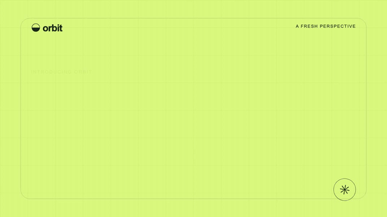
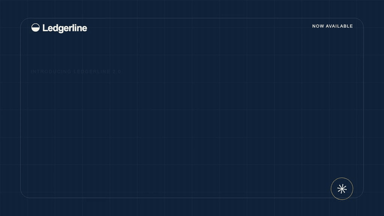

# Framepack free starter

A free [Remotion](https://www.remotion.dev/) project that renders a 12-second product-launch video: an opening title scene and a closing call-to-action scene. You set the brand name, text and colors in one JSON file and export a horizontal or vertical MP4.

It is for developers, and people working with a coding assistant, who are comfortable running `npm` commands and want an editable React source instead of a video editor template.



The default render above uses `props.json` unchanged. The worked example below produces this version from `examples/ledgerline-launch.json`:



## Quickstart

Requires Node.js 22 or newer and npm.

```sh
git clone https://github.com/wmbransford/framepack-starter.git
cd framepack-starter
npm install
npm run render
```

The video is written to `out/launch.mp4` (1280 × 720, 12 seconds, 30 fps). Run `npm run studio` to preview and scrub it in the browser before rendering. If you downloaded a ZIP instead, unzip it and run the last two commands from its folder.

## Worked example: a launch video for your product

This example makes a video for a fictional invoicing product called Ledgerline. Every command below is checked on each push by the repository's render workflow.

1. Copy the example settings and open them:

   ```sh
   cp examples/ledgerline-launch.json props.json
   ```

2. Replace the values with your own product. All fields are optional; a missing field keeps its default.

   ```json
   {
     "brand": "Ledgerline",
     "label": "NOW AVAILABLE",
     "eyebrow": "INTRODUCING LEDGERLINE 2.0",
     "headline": "Invoices that\nsend themselves.",
     "tagline": "Recurring billing for small studios.",
     "closingHeadline": "Start your free\n30-day trial.",
     "closingEyebrow": "LEDGERLINE.EXAMPLE",
     "closingTagline": "No card required. Cancel anytime.",
     "background": "#10223a",
     "foreground": "#f4f1e8",
     "accent": "#f2b84b"
   }
   ```

   | Field | Where it appears | Limit |
   | --- | --- | --- |
   | `brand` | Top-left name in both scenes | 24 characters |
   | `label` | Small top-right text in both scenes | 40 characters |
   | `eyebrow`, `headline`, `tagline` | Opening scene (seconds 0–6) | 55, about 70, 80 characters |
   | `closingEyebrow`, `closingHeadline`, `closingTagline` | Closing scene (seconds 6–12) | 55, about 70, 80 characters |
   | `background`, `foreground`, `accent` | Colors; use six-digit hex | — |

   Use `\n` in a headline for a deliberate line break.

3. Preview, then render both formats:

   ```sh
   npm run studio
   npm run render
   npm run render:vertical
   ```

4. Check the files:

   ```sh
   node scripts/check-render.mjs out/launch.mp4 1280x720 12
   node scripts/check-render.mjs out/launch-vertical.mp4 720x1280 12
   ```

To render the example without overwriting `props.json`, run `npm run render:example`; it writes `out/ledgerline.mp4`.

## Outputs

| Command | File | Size | Duration |
| --- | --- | --- | --- |
| `npm run render` | `out/launch.mp4` | 1280 × 720 | 12 seconds, 30 fps |
| `npm run render:vertical` | `out/launch-vertical.mp4` | 720 × 1280 | 12 seconds, 30 fps |

Both videos are silent. Scenes use system sans-serif fonts and need no external media. Remotion downloads its browser on the first render. If that browser cannot run on your machine, use an installed Chrome:

```sh
npm run render -- --browser-executable="/path/to/chrome"
```

The scene component is `src/FreeLaunch.tsx`; the 12-second sequence and both formats are defined in `src/index.tsx`. Keep all Remotion packages on the same version when upgrading.

## Free starter and the $99 collection

This repository contains two scenes and one sequence, free under the MIT license. No account or payment is required.

The **[Product Launch collection](https://web-production-f36af.up.railway.app/#pricing)** adds six more scenes (feature spotlight, kinetic type, metric reveal, product demo, customer quote, before/after), four transitions and three assembled videos of 12–16 seconds, in horizontal and vertical formats. It costs **$99 once** and includes a commercial license for finished videos. Its source is delivered after purchase and is not in this repository. [Watch previews of every scene](https://web-production-f36af.up.railway.app/#collection).

## License

Original Framepack starter source is [MIT licensed](LICENSE). Third-party dependencies keep their own licenses, including [Remotion's license](https://www.remotion.dev/docs/license), which has its own eligibility rules for commercial use.

Demo names and copy are fictional. Framepack is an independent project and is not affiliated with Remotion.

## Feedback

For bugs or suggestions, [open an issue](https://github.com/wmbransford/framepack-starter/issues) with your Node version, operating system and the steps to reproduce. Do not include API keys or private project files.
